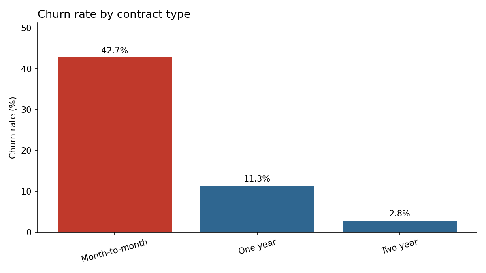
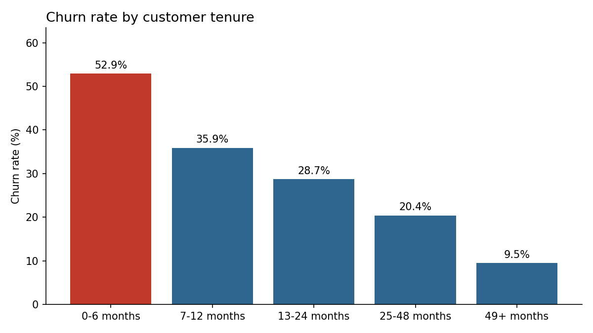
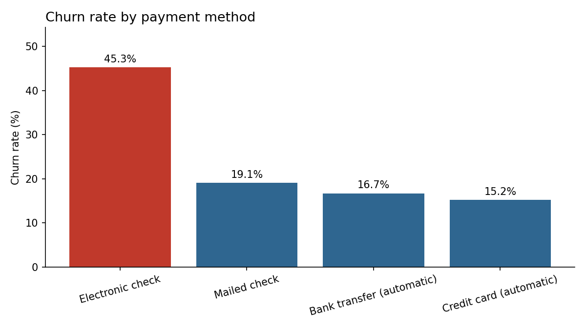

# Telecom Customer Churn Analysis

[](https://colab.research.google.com/github/dataengineerivan/customer_retention_analysis/blob/main/customer_retention_analysis.ipynb)

An analysis of 7,043 telecom customers to find out who is leaving, when they leave, and which group to target first to cut churn. Built with SQL (DuckDB) and Python, with results exported for a Tableau Public dashboard.

The data is IBM's free Telco Customer Churn sample dataset, which the load script downloads automatically.

## Business question

The company is losing more than a quarter of its customers. Where is the churn concentrated, and where would a retention effort have the most impact?

## Key findings

**1. 26.5% of customers churned, taking 30.5% of monthly revenue with them.** 1,869 of 7,043 customers left, accounting for about $139K of $456K in monthly charges. Churned customers paid more per month than average, so the revenue loss is bigger than the customer count suggests.

**2. Contract type is the strongest signal.**

| Contract | Customers | Churn rate |
|---|---|---|
| Month-to-month | 3,875 | 42.7% |
| One year | 1,473 | 11.3% |
| Two year | 1,695 | 2.8% |



**3. Churn is front-loaded.** Over half of customers in their first six months left (52.9%), and that band alone accounts for 41.9% of all churn. The rate falls steadily with tenure, down to 9.5% for customers past four years.



**4. Electronic check customers churn at nearly three times the rate of automatic payers.** 45.3% churn for electronic check, compared with 15.2% to 16.7% for automatic bank transfer and credit card payments.



**5. Support add-ons go with much lower churn.** Fiber optic customers with neither tech support nor online security churned at 55.0%. With both add-ons, the rate was 14.2%.

**6. One segment drives a third of all churn.** Customers who are month-to-month, in their first 12 months, and paying by electronic check make up 14% of the customer base (954 customers). They churn at 63.1% and account for 32.2% of all churned customers.

## Recommendations

1. **Target the high-risk segment first.** It's small enough to act on and accounts for a third of the churn.
2. **Offer an incentive to move from month-to-month to an annual contract**, timed within the first six months, before most churn happens.
3. **Encourage switching to automatic payments** with a small discount or a simpler signup at onboarding.
4. **Bundle tech support or online security into early fiber plans**, and test whether it lowers churn for new customers.

These patterns show which groups churn more, not what causes it. An A/B test of each offer would confirm whether it actually changes customer behavior.

## Walk through the notebook

[`customer_retention_analysis.ipynb`](customer_retention_analysis.ipynb) runs the whole analysis step by step: loading and cleaning the data, each SQL question, the charts, and the findings. GitHub shows it with every result already filled in, so you can read it without running anything. To run it yourself, click **Open in Colab** at the top and choose **Runtime → Run all**. It's free and needs only a Google account.

## Run it on your own computer

```bash
python -m venv .venv
source .venv/bin/activate      # Windows: .venv\Scripts\activate
pip install -r requirements.txt

python src/load_data.py        # downloads the data and builds the DuckDB table
python src/run_analysis.py     # runs every query, saves CSVs and charts to outputs/
```

## Dashboard (Tableau Public, free)

1. Download Tableau Public from public.tableau.com and sign up for a free account.
2. Connect to `outputs/customers_clean.csv`.
3. Create a calculated field: `Churn Rate = AVG([churned])`, formatted as a percentage.
4. Build sheets for churn rate by contract, tenure band, and payment method, plus KPI cards for total customers, churn rate, and lost monthly revenue.
5. Add filters for contract, internet service, and payment method, then combine everything into one dashboard.
6. Publish to Tableau Public and add the link here.

## Data cleaning notes

- `TotalCharges` is blank for 11 brand-new customers with zero tenure. These are kept as missing values instead of zero, so they don't distort averages.
- Yes/No columns are converted to true/false flags, and churn is converted to 1/0 so the churn rate is just its average.
- Tenure is grouped into bands (0–6, 7–12, 13–24, 25–48, 49+ months) to compare customers at different stages.

## Project structure

```
customer_retention_analysis/
├── customer_retention_analysis.ipynb   # the full analysis, start to finish
├── src/
│   ├── load_data.py       # download, clean, and load into DuckDB
│   └── run_analysis.py    # run queries, save CSVs and charts
├── sql/
│   ├── 01_overall_churn.sql
│   ├── 02_churn_by_contract.sql
│   ├── 03_churn_by_tenure.sql
│   ├── 04_churn_by_payment.sql
│   ├── 05_churn_by_service.sql
│   └── 06_high_risk_segment.sql
├── outputs/               # query results, charts, and the dashboard source file
└── requirements.txt
```

## Tools

SQL, Python, DuckDB, pandas, matplotlib, Tableau Public
